  

# 🚀 Awesome Managed Streaming Data Pipelines

  
  
  
  
  
  
  

> **A curated showcase of premier SaaS cloud services, serverless event hubs, and open-source distributed frameworks for real-time streaming data pipelines, continuous ETL, Change Data Capture (CDC), and event-driven architecture.**

---

## 📑 Table of Contents

- [🌐 Sector Overview & Market Dynamics](#-sector-overview--market-dynamics)
- [☁️ SaaS & Hosted Streaming Platforms](#️-saas--hosted-streaming-platforms)
- [⚡ Open-Source GitHub Projects](#-open-source-github-projects)
- [🛠️ Architectural Blueprints & Stack Combinations](#️-architectural-blueprints--stack-combinations)
- [💖 Support & Sponsorship](#-support--sponsorship)
- [📈 Star History](#star-history)
- [🤝 How to Contribute](#-how-to-contribute)
- [⚖️ Disclaimer](#️-disclaimer)

---

## 🌐 Sector Overview & Market Dynamics

The global streaming analytics and event-driven data pipeline market is projected to reach approximately **$54.8 billion by 2028**, expanding at a robust compound annual growth rate (**CAGR**) of **26.8%**. Market dynamics reflect a **moderately fragmented sector transitioning toward specialized concentration**: hyper-scale cloud providers (AWS, Google Cloud) and established enterprise data backbones (Salesforce/Heroku, Confluent) anchor high-volume ingestion and compliance, while disruptive streaming SQL engines, real-time CDC engines, and Rust/Python-native frameworks (Decodable, Redpanda, Estuary, RisingWave, Bytewax) aggressively capture emerging modern data stack and agentic AI workloads.

---

## ☁️ SaaS & Hosted Streaming Platforms

The following hosted and managed stream processing platforms ingest, transform, enrich, and deliver unbounded event streams without low-level cluster provisioning. 

*Sorted in descending order by company scale (Revenue / Valuation):*

| 🏢 Platform | 📝 Key Capabilities & Focus | 💰 Starting Tier Pricing | 🎁 Free Tier / Trial Limits | 📊 Company Scale (Rev / Valuation) |
| :--- | :--- | :--- | :--- | :--- |
| **[Google Cloud Dataflow](https://cloud.google.com/dataflow)** | Fully managed Apache Beam runner for unified batch & streaming processing, dynamic work rebalancing, and exactly-once processing | Starting at **$0.056 per vCPU-hour** and **$0.003557 per GB-hour** for worker memory | **$300 free trial credits** valid for 90 days; free tier includes 1 TB/month BigQuery query analysis | Public (Alphabet): **~$350B+ Annual Revenue** ($2.2T+ Market Cap) |
| **[AWS Kinesis](https://aws.amazon.com/kinesis/)** | Scalable real-time streaming ingestion with Kinesis Data Streams, Firehose delivery, and Managed Apache Flink service | Starting at **$0.015 per shard-hour** + **$0.014 per 1M PUT payload units** (On-Demand: $0.04/stream-hour + $0.08/GB) | **AWS Free Tier**: 1M PUT requests/month for Kinesis Data Streams during the first 12 months; Managed Flink includes $300 AWS trial credits for new accounts | Public (Amazon): **~$620B+ Annual Revenue** ($2.0T+ Market Cap) |
| **[Salesforce Heroku Data Pipelines](https://www.heroku.com/)** | Managed Change Data Capture (CDC) pipelines streaming Postgres write-ahead logs directly to Apache Kafka topics and Heroku apps | Starting at **$100/month** for Apache Kafka on Heroku (Basic-0 plan) | **No permanent free tier**; Heroku provides student/educational credits and promotional trials upon application | Public (Salesforce): **~$38B+ Annual Revenue** (~$280B Market Cap) |
| **[Confluent Cloud](https://confluent.io/confluent-cloud/)** | Enterprise-grade fully managed Apache Kafka service with fully managed connectors, stream governance, ksqlDB, and Apache Flink integration | Starting at **$0.00/month base** with Basic cluster usage at **$0.13 per cluster-hour** + **$0.11 per GB ingress** | **$400 free credits** valid across your first 30 days of Confluent Cloud usage | Public (CFLT): **~$1.0B+ Annual Revenue** (~$7B Market Cap) |
| **[Aiven for Apache Kafka](https://aiven.io/kafka)** | Fully managed multi-cloud Apache Kafka with built-in Schema Registry, Kafka Connect, Karapace, and Apache Flink streaming services | Starting at **$150/month** (~$0.208/hour) for Startup-2 single-node development plan | **$300 free trial credits** valid for 30 days across all Aiven managed database & streaming services | Private: **~$100M+ ARR** (~$3.0B Valuation) |
| **[Redpanda Cloud](https://redpanda.com/)** | C++ Kafka API-compatible real-time streaming engine with built-in tiered storage, zero ZooKeeper overhead, and sub-millisecond latencies | Serverless starting at **$0.14 per GB written** ($0.00/hr cluster fee) | **$300 free credits** valid for 14 days on Redpanda Serverless | Private: **Series C**, ~$115M Raised (~$800M Valuation) |
| **[Estuary Flow](https://estuary.dev/)** | Managed real-time streaming ETL platform featuring zero-setup Change Data Capture (CDC), streaming SQL, and 200+ destinations | Starting at **$20/month** for Starter Tier ($0.50/GB after credit exhaustion) | **Free Forever Tier**: Up to **10 GB data transfer/month** and 2 concurrent real-time tasks; plus 30-day trial with 1 TB data allowance | Private: **Series A**, ~$23M Raised (~$100M Valuation) |
| **[Decodable](https://www.decodable.co/)** | Serverless real-time data engineering platform powered by Apache Flink with SQL pipelines and managed sources/sinks | Starting at **$0.99 per pipeline hour** (Pay-as-you-go) | **Free Forever Plan**: Includes up to **1 active pipeline**, 1 source connection, 1 sink connection, and up to 10 GB processed per month | Private: **Series A**, ~$35M Raised (~$120M Valuation) |
| **[Upstash Kafka](https://upstash.com/kafka)** | Serverless pay-per-message Apache Kafka compatible service with REST/HTTP APIs, designed for edge, serverless, and Next.js applications | Starting at **$0.60 per 100,000 messages** (Pay-As-You-Go plan) | **Free Forever Tier**: Up to **10,000 messages per day** and 256 MB storage limit with single-region support | Private: **Seed / Series A**, ~$15M Raised (~$60M Valuation) |
| **[Bytewax Cloud](https://bytewax.io/)** | Fully managed enterprise control plane and deployment environment for Python and Rust stream processing pipelines | Starting at **$499/month** for Team Tier deployment cluster | **Free Tier / Sandbox**: Free forever local development SDK with full features; 14-day free trial on Cloud managed orchestrator | Private: **Seed**, ~$5M Raised (~$25M Valuation) |

---

## ⚡ Open-Source GitHub Projects

Explore the top open-source distributed engines, stream compute runtimes, streaming databases, and message brokers for building self-hosted, sovereign real-time architectures.

*Sorted in descending order by GitHub Stars ⭐:*

| 🛠️ Project | ⭐ Stars | 📜 License | 📖 Description & Architectural Role |
| :--- | :--- | :--- | :--- |
| **[ClickHouse](https://github.com/ClickHouse/ClickHouse)** |  | Apache-2.0 | Ultra-fast columnar streaming analytics database with native Kafka/vector tables and real-time materialized views. |
| **[Apache Spark](https://github.com/apache/spark)** |  | Apache-2.0 | Unified analytics engine featuring **Spark Structured Streaming** for scalable micro-batch and continuous event processing. |
| **[Apache Airflow](https://github.com/apache/airflow)** |  | Apache-2.0 | The industry standard for programmatic workflow orchestration, coordinating stream consumers and batch reconciliation. |
| **[Apache Kafka](https://github.com/apache/kafka)** |  | Apache-2.0 | High-throughput distributed event streaming platform with log retention, pub/sub topics, and the Kafka Streams library. |
| **[Apache Flink](https://github.com/apache/flink)** |  | Apache-2.0 | True stream-first distributed computation engine featuring event-time windows, stateful processing, and exactly-once semantics. |
| **[Vector](https://github.com/vectordotdev/vector)** |  | MPL-2.0 | High-performance Rust-based observability and event pipeline for collecting, transforming, and routing logs, metrics, and streams. |
| **[Airbyte](https://github.com/airbytehq/airbyte)** |  | ELv2 | Extensible data integration engine supporting real-time Change Data Capture (CDC) and connector sync pipelines. |
| **[NATS Server](https://github.com/nats-io/nats-server)** |  | Apache-2.0 | Cloud-native, lightweight messaging system with **NATS JetStream** for persistent stream storage and deduplication. |
| **[Apache Pulsar](https://github.com/apache/pulsar)** |  | Apache-2.0 | Distributed pub-sub messaging architecture with decoupled compute/storage tiers (Apache BookKeeper) and multi-tenancy. |
| **[Debezium](https://github.com/debezium/debezium)** |  | Apache-2.0 | Low-latency Change Data Capture (CDC) platform capturing row-level changes from Postgres, MySQL, MongoDB, and Oracle into Kafka. |
| **[Redpanda](https://github.com/redpanda-data/redpanda)** |  | BSL / Source-Available | C++ Kafka-compatible streaming engine operating without JVM garbage collection pauses or ZooKeeper requirements. |
| **[RisingWave](https://github.com/risingwavelabs/risingwave)** |  | Apache-2.0 | PostgreSQL-compatible streaming database that replaces Flink + Kafka + serving layers with continuous SQL materialized views. |
| **[Delta Lake](https://github.com/delta-io/delta)** |  | Apache-2.0 | ACID lakehouse storage layer enabling continuous streaming ingestion, compaction, and time travel over parquet data. |
| **[Redpanda Connect](https://github.com/redpanda-data/connect)** |  | Apache-2.0 | Resilient stream processor (formerly Benthos) with 200+ connectors and declarative mapping for fast pipeline routing. |
| **[Apache Beam](https://github.com/apache/beam)** |  | Apache-2.0 | Portable programming model for defining data pipelines executed across Flink, Spark, and Google Cloud Dataflow runners. |
| **[Apache Storm](https://github.com/apache/storm)** |  | Apache-2.0 | Distributed real-time stream computation system utilizing spouts and bolts for fault-tolerant unbounded data processing. |
| **[Apache Pinot](https://github.com/apache/pinot)** |  | Apache-2.0 | Real-time distributed OLAP datastore designed for low-latency user-facing analytics directly over streaming event sources. |
| **[FastStream](https://github.com/ag2ai/faststream)** |  | Apache-2.0 | Modern Python framework for event-driven microservices integrating Kafka, RabbitMQ, NATS, Redis Streams, and AsyncAPI. |
| **[SQLFlow](https://github.com/sql-machine-learning/sqlflow)** |  | Apache-2.0 | SQL-to-pipeline compiler uniting SQL data processing and AI/ML model training over stream connections. |
| **[Arroyo](https://github.com/ArroyoSystems/arroyo)** |  | Apache-2.0 | High-performance distributed stream processing engine built in Rust with real-time SQL and checkpoint recovery. |
| **[Infinity](https://github.com/infiniflow/infinity)** |  | Apache-2.0 | Real-time AI-native database offering streaming vector, multi-vector, and full-text hybrid indexing for LLM applications. |
| **[Memphis](https://github.com/superstreamlabs/memphis)** |  | Apache-2.0 | Developer-friendly real-time data streaming platform featuring built-in schema verification and Dead Letter Queues (DLQ). |
| **[Rill](https://github.com/rilldata/rill)** |  | Apache-2.0 | Fast BI and operational metrics layer transforming streaming data into instant dashboards via DuckDB and ClickHouse. |
| **[Numaflow](https://github.com/numaproj/numaflow)** |  | Apache-2.0 | Kubernetes-native parallel stream processing system for event-driven microservices and massive continuous pipelines. |
| **[Timeplus Proton](https://github.com/timeplus-io/proton)** |  | Apache-2.0 | Fast unified streaming SQL engine in a single C++ binary powered by ClickHouse cores with millisecond latency. |
| **[Feldera](https://github.com/feldera/feldera)** |  | MIT / Apache-2.0 | Incremental computation engine evaluating arbitrary relational SQL queries continually on streaming data delta sets. |
| **[Bytewax](https://github.com/bytewax/bytewax)** |  | Apache-2.0 | Python-first stream processing framework backed by a high-throughput Rust distributed dataflow engine. |
| **[Onyx](https://github.com/onyx-platform/onyx)** |  | EPL-1.0 | Distributed, masterless, information-model data processing platform written in Clojure. |
| **[Siddhi](https://github.com/siddhi-io/siddhi)** |  | Apache-2.0 | Cloud-native Complex Event Processing (CEP) and streaming SQL library with lightweight embedding capabilities. |
| **[Quix Streams](https://github.com/quixio/quix-streams)** |  | Apache-2.0 | Pure Python stream processing library for Kafka with Pandas-like DataFrame semantics and stateful windowing. |
| **[Wally](https://github.com/WallarooLabs/wally)** |  | Apache-2.0 | Reactive stream processing engine designed for ultra-low latency real-time algorithms and data pipelines. |
| **[Estuary Flow Engine](https://github.com/estuary/flow)** |  | Apache-2.0 | Real-time continuous data integration engine managing synchronized data flows and materialized collections. |
| **[Apache Samza](https://github.com/apache/samza)** |  | Apache-2.0 | Stateful stream processing framework with state stores (RocksDB) and high-throughput Apache Kafka integrations. |

---

## 🛠️ Architectural Blueprints & Stack Combinations

When engineering real-time data pipelines, data platforms typically combine specialized layers:

- **Ingestion & CDC Layer**: [Debezium](https://github.com/debezium/debezium) or [Airbyte](https://github.com/airbytehq/airbyte) for database transaction logs (PostgreSQL WAL, MySQL binlog).
- **Event Backbone / Log Transport**: [Apache Kafka](https://github.com/apache/kafka), [Redpanda](https://github.com/redpanda-data/redpanda), or [NATS JetStream](https://github.com/nats-io/nats-server) for durable, replayable pub-sub partitions.
- **Continuous Stream Processing**: [Apache Flink](https://github.com/apache/flink) for high-scale stateful stream processing, [Bytewax](https://github.com/bytewax/bytewax) / [Quix Streams](https://github.com/quixio/quix-streams) for Python-native pipelines, or [Arroyo](https://github.com/ArroyoSystems/arroyo) for Rust-level speed.
- **Incremental & Analytical Serving**: [RisingWave](https://github.com/risingwavelabs/risingwave) or [Timeplus Proton](https://github.com/timeplus-io/proton) for streaming SQL materialized views; [ClickHouse](https://github.com/ClickHouse/ClickHouse) or [Apache Pinot](https://github.com/apache/pinot) for sub-second analytical aggregations; [Delta Lake](https://github.com/delta-io/delta) for storage.
- **Orchestration & Governance**: [Apache Airflow](https://github.com/apache/airflow) for scheduled pipeline management and [Vector](https://github.com/vectordotdev/vector) for observability telemetry.

---

## 🤝 How to Contribute

Contributions are warmly welcomed! Help keep this repository the definitive streaming data pipeline resource:

1. **Fork the repository** to your own GitHub account.
2. **Add or refine an entry** in `README.md` following the table formatting and pricing/feature conventions.
3. Verify that project URLs, license details, and pricing tier descriptions are current and accurate.
4. **Submit a Pull Request** with a concise summary of additions.

⭐ *Don't forget to star this repository if it helps your data engineering journey!*

## 💖 Support & Sponsorship

If you find this curated ecosystem directory helpful, consider supporting the continuous maintenance and curation of open-source resources:

- ⭐ **Star this repository** to help others discover it.
- 🍴 **Fork and share** it with your data engineering team, colleagues, and community.
- ☕ **Buy a coffee & sponsor**: Support the creator on GitHub Sponsors at [**https://github.com/sponsors/ishandutta2007**](https://github.com/sponsors/ishandutta2007).

Your backing and sponsorship help keep this list up-to-date with emerging engines and production benchmarks! Thank you! 🙌

---

##  Star History

---

## ⚖️ Disclaimer

- This repository is a community-curated, independent directory and does not constitute an endorsement.
- All product names, logos, and brands are property of their respective owners.
- Cloud pricing tiers, API quotas, and free tier allowances may change; check vendor official sites for real-time terms.
